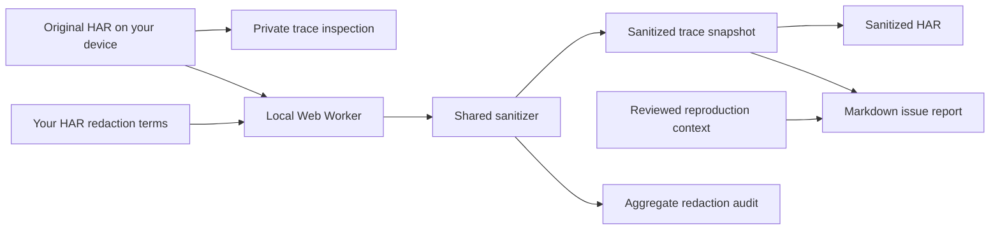

# TraceTidy

**Turn a sensitive browser HAR into a reviewable bug report—without sending it to a server.**

[简体中文](README.zh-CN.md) · [Security model](docs/THREAT-MODEL.md) · [Launch plan](docs/LAUNCH.md) · [Contributing](CONTRIBUTING.md)

**New in v0.2:** clickable triage observations, endpoint groups and P95 latency, editable reproduction context, and Web Worker processing with cached exports. [Repository](https://github.com/qsxustc/tracetidy) · [Performance and measurement](docs/PERFORMANCE.md)

Browser network captures are useful when a request fails. They can also contain session cookies, bearer tokens, request payloads, response bodies, private domains, and customer details. TraceTidy helps developers remove that baggage before asking someone else to debug a problem.

Open a HAR locally, inspect the original network timings, then export a sanitized HAR, a Markdown issue report, and an aggregate redaction audit. The browser app and CLI use the same sanitizer. **All export formats come from the same sanitized snapshot.**


*The screenshots use the included synthetic demo: 15 requests and 4 failures. No real customer trace is shown.*

## What works today

- Clickable observations for network errors, HTTP 4xx/5xx, slow waiting/receiving, and repeated endpoints. These describe recorded patterns; they do not establish a root cause.
- Endpoint groups by method, origin and path, with request/error counts, P95, average and summed duration. Filters choose which groups appear; group metrics cover the complete trace. Unknown duration uses recorded phases or 0, which can understate latency statistics.
- Editable issue title, reproduction steps, expected behavior and actual behavior. Written context is included as entered and is not scrubbed by HAR redaction terms; review it before sharing.
- Parsing, analysis, sanitization, report serialization and ZIP creation in a module Web Worker. Rule changes disable export until the newest snapshot succeeds; clearing a session cancels work and discards pending results.
- A local browser workspace with drag-and-drop HAR import, URL/method/status search, failed/slow request filters, and sorting by start time, duration, or size.
- A waterfall and request inspector with timing breakdowns. Original headers are available in an explicitly expanded private view.
- An immediately available synthetic sample, English/Chinese language detection and switching, and a **Clear session** action. Imported traces and private terms stay in memory; they are not saved to browser storage and disappear when the tab is reloaded or closed.
- An ESM command-line tool with file input, stdin, custom private terms, and optional Markdown/audit output.
- Removal of request and response bodies, cookies, sensitive headers, and unrecognized HAR fields through an explicit field allowlist.
- Masking of query values and common sensitive strings. Default exports also replace hostnames, paths, and query parameter names with stable aliases, preserving repeated-request relationships without exporting an alias map.
- A sanitized Markdown report with request counts, failures, timings, and a request table.
- An aggregate audit manifest so a reviewer can see what the tool changed.
- A **Download share pack** ZIP containing `safe.har`, `issue.md`, and `audit.json` from the same sanitized snapshot—without the original HAR or an alias mapping. Individual HAR/report downloads and report copying are also available.
- Zero runtime dependencies. No API key, account, or server is required.

This is a **HAR tool**. It does not process screenshots, PDFs, video, generic text files, or OCR.


*Review the sanitized preview and removal counts before downloading the share pack. Default public-share mode replaces endpoints with aliases.*

## Run locally

Use Node.js 20 or newer. Clone or download this repository, then run these commands from its directory:

```sh
npm start
```

Open the local URL printed by the server. Try the included synthetic [demo HAR](samples/demo.har). A package installation is not required; the app uses native browser modules and Node.js built-ins.

The browser accepts files up to 25 MiB. Core validation limits source text to 50 MiB, request count to 50,000, and individual URLs to 32 KiB; the CLI uses those core limits. Smaller captures are easier to investigate and review.

```sh
npm test
npm run build

# Repeatable, in-memory synthetic core measurement; no trace data collected.
npm run benchmark
```

The build produces the static browser app in `dist/`. See [the launch plan](docs/LAUNCH.md) for a GitHub Pages deployment workflow.

## Command line

```sh
# Export a HAR, a shareable Markdown issue draft, and redaction counts.
node bin/tracetidy.js samples/demo.har \
  --output safe.har \
  --report issue.md \
  --audit audit.json

# Add known private names or project identifiers. Repeat --term as needed.
node bin/tracetidy.js input.har --output safe.har \
  --term "Private Project" --term "Customer Name"

# Pipe input; the sanitized HAR goes to stdout and summary goes to stderr.
cat input.har | node bin/tracetidy.js - > safe.har

node bin/tracetidy.js --help
```

The CLI writes only the sanitized HAR to stdout by default. With `--output`, stdout is empty. Status messages contain aggregate counts, never original URLs or hostnames. Existing output files require `--force`; the tool rejects replacing the original input, including symlink and hardlink aliases. File exports are created with owner-only permissions where supported, and each file is published atomically. Output directories must already exist. A set of multiple exports is not a single filesystem transaction.

Exit codes: `0` for success, `1` for file access or processing errors, `2` for invalid arguments or HAR format. Error messages deliberately omit input contents and file paths.

Prefer `--output` for file writes. Shell redirection happens before the CLI can protect the source; never redirect stdout to the original input path.

For a private debugging session where a real endpoint name is essential:

```sh
node bin/tracetidy.js input.har --output private-debug.har --preserve-routes
```

`--preserve-routes` retains scrubbed hostnames, paths, and query names. It increases the chance that an export identifies a person, customer, or organization; the CLI warns when it is enabled. Extra terms supplied on the command line can appear in shell history or process listings.

The project has **not been published to npm**. Use the repository commands above.

## Review before sharing

TraceTidy is deterministic, heuristic redaction, **not a guarantee of anonymization**. Default route aliases reduce exposure, but an unusual secret can still appear in a retained value, and status/timing/size patterns can reveal context. Human names are not reliably recognized; add them as private terms. Preserving routes leaves domain names and path structure available to the recipient.

The original file stays on your device. The app can show the original trace for your private investigation, so screen sharing and screenshots can still expose it. Sanitization removes information irreversibly from the export: **no secret-to-placeholder or route-alias mapping is generated or recoverable from TraceTidy.** Keep the original only in a location you control if further debugging requires it.

Read the [threat model](docs/THREAT-MODEL.md) for the trust boundaries and review checklist. Use synthetic data in public issues and pull requests.

The browser app needs module Web Workers and a local HTTP server or hosted HTTPS page. Opening `index.html` directly with `file://` is not supported. The CLI remains available without a browser. Processing has no telemetry or network requests beyond loading app modules and the fixed synthetic sample.

## How it fits together



The browser interface talks to `src/trace-worker.js` through `src/processor.js`. The Worker and CLI import the same ESM core in `src/har.js`. The core validates the input shape, exports explicitly allowed HAR fields, applies sensitive-value rules, and builds the issue draft from the sanitized result. Original trace details are used only for private inspection. Reviewed author context is added to the report separately. The app does not need a backend or network service to process a file.

## Why open source—and how it could become a business

The immediate goal is a useful, inspectable handoff tool: fewer accidental credentials in support tickets and better evidence in bug reports. Local processing and a readable sanitizer make that promise easier to assess.

A paid product would need customer validation first. Team redaction policies, reviewed policy packs, integrations with support workflows, and organization controls are **planned hypotheses**, not implemented features. The free local app and CLI are intended to remain useful on their own. [The launch plan](docs/LAUNCH.md) explains the validation steps, success metrics, and possible paid scope.

Contributions are welcome, especially synthetic leak cases, browser compatibility fixes, and accessibility improvements. Start with [CONTRIBUTING.md](CONTRIBUTING.md).

MIT licensed. See [LICENSE](LICENSE).
