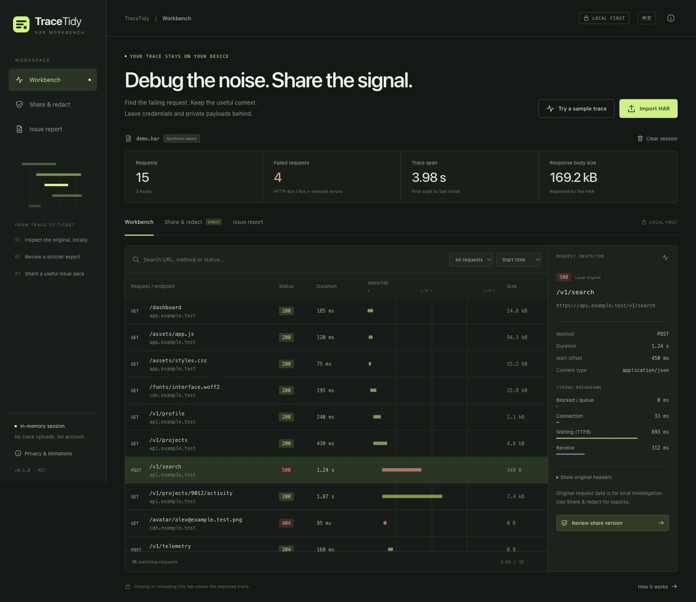
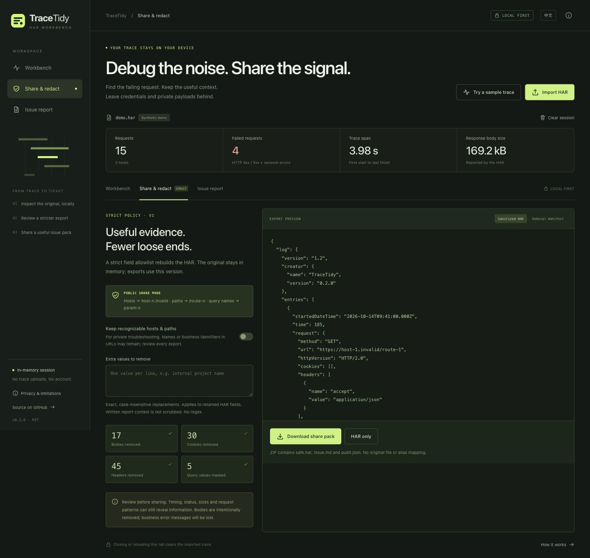

# TraceTidy

**把可能包含敏感信息的浏览器 HAR，整理成可以检查后分享的故障报告。整个处理过程在本地完成。**

[English](README.md) · [安全模型](docs/THREAT-MODEL.md) · [发布与商业验证计划](docs/LAUNCH.md) · [参与贡献](CONTRIBUTING.md)

**[直接体验公开演示，无需登录](https://tracetidy-lab-qsx.cherryboar4.chatgpt.site/)** · [下载最新打包版本（v0.2.0）](https://github.com/qsxustc/tracetidy/releases/tag/v0.2.0) · [v0.3.0 更新说明](docs/releases/v0.3.0.md) · [中英文推广文案](docs/PROMOTION.md)

**v0.3 新增：** 对比基线与当前抓包，查找接口性能回退，跳转到相关请求，并导出隐藏原始接口名称的对比报告。[GitHub 仓库](https://github.com/qsxustc/tracetidy) · [性能与测量说明](docs/PERFORMANCE.md)

排查网络请求时，HAR 很有用，但它也可能携带登录 Cookie、Bearer Token、请求数据、响应正文、内部域名和客户信息。TraceTidy 帮助开发者在提交 Issue 或支持工单之前，先清理这些内容。

你可以在浏览器中导入 HAR，私下查看原始请求与耗时，对比之前的抓包，再导出可供检查的排障材料。浏览器和命令行使用同一个清理引擎，**清理后的 HAR、Markdown 故障报告和脱敏计数来自同一份清理后的快照。** 网页版对比报告使用匿名接口编号，导出数值变化。



*截图使用仓库内的合成示例：15 个请求、4 个失败请求，没有使用真实客户抓包。*

## 现在能做什么

- 查看网络失败、4xx/5xx、慢等待、慢接收及重复接口等排障线索，点击即可筛选对应请求。这些提示描述观察到的模式，不代表已确定故障根因。
- 按方法、域名和路径聚合接口，查看调用/失败次数、P95、平均与累计耗时。筛选只决定展示哪些组，聚合指标始终来自完整抓包。缺失总耗时会汇总阶段耗时，完全缺失时按 0 计入，因此可能低估延迟统计。
- 在**抓包对比**页比较之前与当前的抓包，调整 P95 阈值，搜索接口并按变化类型筛选，点击即可跳转到当前抓包的相关请求。可以导入自己的基线，也可以试用内置合成基线。
- 在报告页补充问题标题、复现步骤、预期行为和实际行为。手写内容会原样加入报告，HAR 自定义清理词不会处理它，需要人工检查。
- 解析、诊断、清理、报告序列化和 ZIP 生成都在模块 Web Worker 中完成。修改规则后立即禁用导出，只有最新快照成功后才能下载；清空会话会取消处理并丢弃未完成结果。
- 拖入 `.har`，按 URL、方法或状态搜索，筛选失败/慢请求，按开始时间、耗时或大小排序。
- 通过瀑布图和请求检查器查看耗时分解；原始请求头需要显式展开，只用于私下排查。超大请求头会在拼接预览字符串之前截断，并显示截断提示。
- 打开即可体验合成示例，中英文自动选择且可以切换。**清空本次会话** 可以移除内存中的抓包；导入文件和私密词不写入浏览器存储，关闭或刷新标签页也会清除。
- 用命令行读取文件或 stdin，并选择导出 HAR、Markdown 报告和 audit JSON。
- 通过明确的字段允许列表，去掉请求/响应正文、Cookie、敏感请求头以及不认识的 HAR 扩展字段。
- 遮盖查询参数值和常见敏感字符串。默认还会把域名、路径和查询参数名替换成稳定别名，让重复请求仍然可以对照，但不会导出别名映射。
- 添加你知道的人名、客户名称、项目标识等自定义私密词。
- 生成请求数量、失败、耗时和请求表格组成的 Markdown 草稿。
- 输出只有计数的脱敏 audit，方便检查工具实际做了哪些处理。
- **下载分享包** 一次得到包含 `safe.har`、`issue.md`、`audit.json` 的 ZIP，这三份文件来自同一份清理后的快照；对比完成后还会加入 `comparison.md`。分享包不包含原始 HAR 或别名映射；也可以单独下载 HAR/报告，或复制报告。
- 无运行时依赖；不需要账号、API Key 或后端服务。

目前只处理 **HAR**，不支持截图、PDF、视频、通用文本清理或 OCR。



*下载分享包之前，先检查导出预览和移除计数。默认公开分享模式会把端点替换为别名。*

## 对比两次抓包

1. 导入当前 HAR，或打开合成示例。
2. 打开**抓包对比**，选择**导入基线 HAR**。体验完整示例时，先打开当前示例，再选择**体验示例基线**；这对合成抓包展示性能回退、改善、新增与消失的接口。
3. 查看整体摘要与接口表格，按方法或接口搜索，筛选回退、改善、新增、移除或无明显变化的接口。点击有当前请求的接口，可以在网络工作区查看对应请求。
4. 按需要调整 P95 阈值，再单独下载 `comparison.md`，或通过分享包下载。筛选只改变可见表格，不改变统计指标或导出的对比结果。

只有规范化的方法、origin 和精确路径相同时，接口才会匹配。匹配忽略查询参数与 fragment；域名、端口、协议、方法或路径结尾的斜杠不同，都会形成不同的分组。工具不会猜测不同服务或部署下的地址是否代表同一个操作。

默认延迟回退规则要求**同时满足 P95 增加至少 100 ms，且增加量达到基线 P95 的 20%**。失败率只要上升，也会标记为回退，即使耗时有所改善。失败包括 HTTP 4xx/5xx 和 status 0。延迟改善使用同样的两个阈值，百分比仍以基线为分母；新增或消失的接口没有成对的耗时证据。基线为 0 时不计算相对变化百分比。

对比报告始终使用 `endpoint-N` 编号隐藏原始域名和路径，即使 `safe.har` 选择保留路由也如此。这些编号能在两次抓包间指向同一个分组，但**与 `safe.har` 的 `host-N`、`route-N` 别名彼此独立**，不会导出映射。报告保留完整的抓包汇总与变化计数，默认展示最多 **100 个接口行**，优先级依次为回退、新增、移除、改善、无明显变化，再按 P95 增加量排序；浏览器表格可以查看全部分组。

请比较相同操作流程和近似环境下的抓包。样本较小、请求数量变化、缓存冷热或网络变化，都可能影响 P95 与失败率；分类表示记录中的差异，并不能证明代码回退，也不是统计显著性检验。P95 使用 nearest-rank 方法；缺失总耗时会汇总已记录的阶段耗时，完全缺失时按 0 计入，可能低估延迟。累计耗时包括并行请求，不能当作实际经过的时间。

原始基线只留在本地 Worker 内存中。导入新的当前抓包、清空会话、刷新或关闭标签页，都会丢弃基线与对比结果，也可以在**抓包对比**页移除基线。基线不会写入浏览器存储或加入导出文件。目前对比功能在网页版提供；CLI 仍然清理和导出单次抓包。

## 本地运行

需要 Node.js 20 或更新版本。下载或克隆仓库，在仓库目录运行：

```sh
npm start
```

打开终端显示的本地地址，可以先试用仓库内的合成 [当前抓包 demo.har](samples/demo.har) 和 [基线 baseline.har](samples/baseline.har)。项目使用浏览器原生模块和 Node.js 内置库，不需要先运行 `npm install`。

浏览器导入文件上限为 25 MiB。核心校验限制原始文本为 50 MiB、请求数量为 50,000、单个 URL 为 32 KiB，CLI 使用这些核心限制。较小的抓包更容易排查和人工检查。

```sh
npm test
npm run build

# 内存中生成合成数据，重复测量核心处理；不收集真实抓包。
npm run benchmark
```

构建会在 `dist/` 生成静态网页。GitHub Pages 的发布步骤见 [LAUNCH.md](docs/LAUNCH.md)。

## 命令行

```sh
# 一次导出清理后的 HAR、Markdown 报告和计数。
node bin/tracetidy.js samples/demo.har \
  --output safe.har \
  --report issue.md \
  --audit audit.json

# 自定义私密词可以重复指定。
node bin/tracetidy.js input.har --output safe.har \
  --term "内部项目名" --term "客户姓名"

# 默认把清理后的 HAR 输出到 stdout，状态摘要输出到 stderr。
cat input.har | node bin/tracetidy.js - > safe.har

node bin/tracetidy.js --help
```

指定 `--output` 后 stdout 为空。状态信息只包含汇总计数，不包含原始 URL 和域名。默认不覆盖已有文件；`--force` 可以覆盖输出，但仍然不能覆盖原始输入，包括指向输入的软链接和硬链接。导出文件在支持的平台上使用仅文件所有者可读写的权限，每个文件采用原子发布。输出目录需要预先存在；多个导出文件不是一个整体的文件系统事务。

退出码：`0` 成功，`1` 文件访问或处理错误，`2` 参数或 HAR 格式错误。错误信息不会回显输入内容和路径。

写入文件优先使用 `--output`。shell 重定向会在 CLI 启动前处理文件，因此不要把 stdout 重定向到原始输入路径。

如果仅在私下排障时必须保留真实端点，可以显式选择：

```sh
node bin/tracetidy.js input.har --output private-debug.har --preserve-routes
```

这会保留经过规则清理的域名、路径和参数名，并提示泄露身份信息的风险。命令行里的自定义私密词可能出现在 shell 历史记录和进程列表中。

项目**尚未发布到 npm**；请使用上面的仓库命令。

## 分享前仍然需要检查

TraceTidy 是确定性的规则清理工具，**不保证匿名化**。默认的路由别名可以减少泄露，但未被识别的私密内容仍可能留在允许保留的字段中，状态码、耗时与大小也可能暴露业务背景。人名不能可靠地自动识别，需要加入自定义私密词。选择保留真实路由时，域名与路径结构仍然会暴露给接收者。

原始 HAR 保留在你的设备上，界面可以展示它供私下排查，因此共享屏幕或截图仍然可能泄露内容。清理会不可逆地删除导出中的信息：**工具不生成可供恢复的秘密映射或路由别名映射。** 如后续需要排障，请把原始文件保存在你控制的位置。

完整的信任边界与检查建议见 [安全模型](docs/THREAT-MODEL.md)。公开 Issue 和 Pull Request 只使用合成数据。

网页版需要支持模块 Web Worker 的现代浏览器，并通过本地 HTTP 或在线 HTTPS 访问；不支持直接双击以 `file://` 打开 `index.html`。CLI 不需要浏览器。除应用模块和固定的合成示例外，处理不会发起网络请求，也不采集遥测。

## 开源与商业方向

项目首先解决一个具体问题：减少支持工单里的意外凭证泄露，并让故障材料更容易检查。清理逻辑可以阅读、运行和测试，本地处理降低了分享原始文件的需要。

未来可能收费的方向包括团队脱敏策略、审核过的规则包、支持工单集成和组织管理。这些目前是**待验证的产品假设**，并没有实现，也没有收入或星数保证。免费本地应用和 CLI 应当独立可用。具体访谈、发布指标和收费验证方法见 [发布计划](docs/LAUNCH.md)。

欢迎贡献合成泄露案例、浏览器兼容性和无障碍改进。开发方式见 [CONTRIBUTING.md](CONTRIBUTING.md)。

MIT 协议，见 [LICENSE](LICENSE)。
